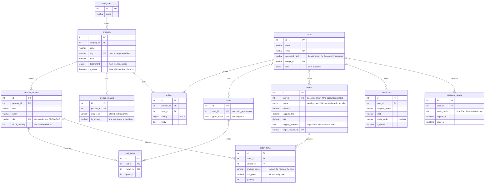

# The database

DeniseClothing stores everything in a MySQL database: products, customers, carts, orders and reviews. This page explains what's stored where and how the pieces connect. The tables themselves are created by [`db/schema.sql`](../db/schema.sql).

## The short version

- A **product** (like "Oversized Linen Shirt") comes in several **variants**, one for each size and colour, and each variant has its own stock count.
- A **customer** has one **cart**, can place many **orders**, can save **addresses** and can write **reviews**.
- An **order** keeps its own copy of what was bought and where it was sent, so it stays correct even if a product or address changes later.

## Diagram

Each box is a table. A line means one table points to another. The symbols at each end show how many: `||` means exactly one, `o|` means zero or one, `o{` means zero or more.



There's also a `sessions` table that keeps people logged in. It's created automatically by `express-mysql-session` when the app first starts, so it isn't in `schema.sql`.

## What each table is for

| Table                      | What it holds                                                          |
| -------------------------- | ---------------------------------------------------------------------- |
| `categories`             | Groups like Tops, Bottoms, Outerwear                                   |
| `products`               | One row per item: name, description, price, department                 |
| `product_variants`       | Each size and colour of a product, with its own stock count and SKU    |
| `product_images`         | Photo links for each product, and which one is the main photo          |
| `users`                  | Accounts. Passwords are stored as bcrypt hashes, never as typed        |
| `carts` / `cart_items` | What's in each cart. A cart belongs to either a user or a guest        |
| `orders`                 | One row per checkout, with totals, delivery details and payment status |
| `order_items`            | The lines of each order, copied at the moment of purchase              |
| `reviews`                | Star ratings and comments. Only buyers can post one                    |
| `addresses`              | Saved delivery addresses for faster checkout                           |
| `password_resets`        | Open "forgot password" requests, stored as hashes                      |

## What happens when something is deleted

When a row is deleted, MySQL needs to know what to do with the rows that point to it. I picked a rule for each relationship based on what the data means.

| If you delete...                   | ...then                                                        | Rule         | Why                                                  |
| ---------------------------------- | -------------------------------------------------------------- | ------------ | ---------------------------------------------------- |
| A user                             | Their **orders stay**, but no longer point to them       | `SET NULL` | Sales records have to stay correct                   |
| A user                             | Their **reviews** are deleted                            | `CASCADE`  | A review shows the person's name                     |
| A user                             | Their **addresses, cart and reset requests** are deleted | `CASCADE`  | Personal data with no reason to keep                 |
| A product                          | Its **variants, images and reviews** are deleted         | `CASCADE`  | They don't mean anything without the product         |
| A variant                          | **Past order lines stay**, just unlinked                 | `SET NULL` | The order already has its own copy of name and price |
| A category that still has products | **Not allowed**                                          | `RESTRICT` | Stops products being orphaned by accident            |
| An order                           | Its **order lines** are deleted                          | `CASCADE`  | They're part of the order                            |

In practice, products are almost never deleted. The admin hides them with `is_active` instead, so the `CASCADE` rules on products are a backup more than something used day to day.

## Rules the database enforces itself

Most of these are also checked in the code, but having the database enforce them means a bug in the code still can't break the data.

**Unique values** (no two rows can have the same):

- `users.email`: one account per email
- `product_variants.sku`, and the pair `(product_id, size, color)`: no duplicate sizes on a product
- `cart_items (cart_id, variant_id)`: adding the same item again increases the quantity instead of adding a second line
- `reviews (product_id, user_id)`: one review per person per product
- `orders.stripe_session_id`: one Stripe checkout can't create two orders

**Checks:**

- `stock_quantity >= 0`, so stock can't go negative
- `cart_items.quantity > 0`
- `reviews.rating BETWEEN 1 AND 5`
- `products.price >= 0`

**Money** is stored as `DECIMAL(10,2)` everywhere. `FLOAT` can't store values like 0.10 exactly, and those small errors add up in totals.

## Setting it up

```bash
mysql -u root -p -e "CREATE DATABASE denise CHARACTER SET utf8mb4"
mysql -u root -p denise < db/schema.sql
```

`utf8mb4` lets names and reviews contain any character, including emoji. Plain `utf8` in MySQL can't store emoji.
